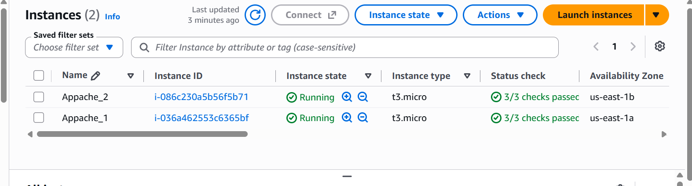
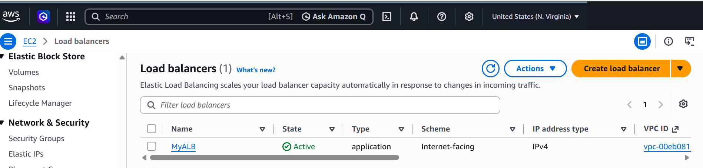
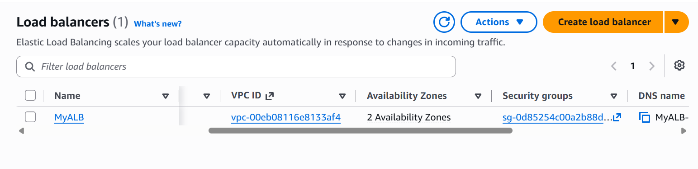
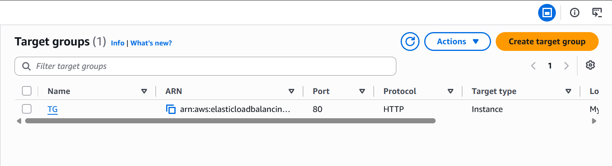
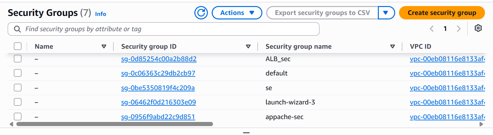
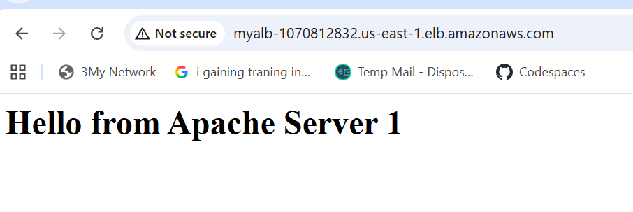
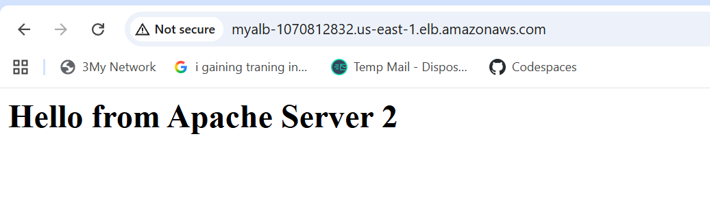
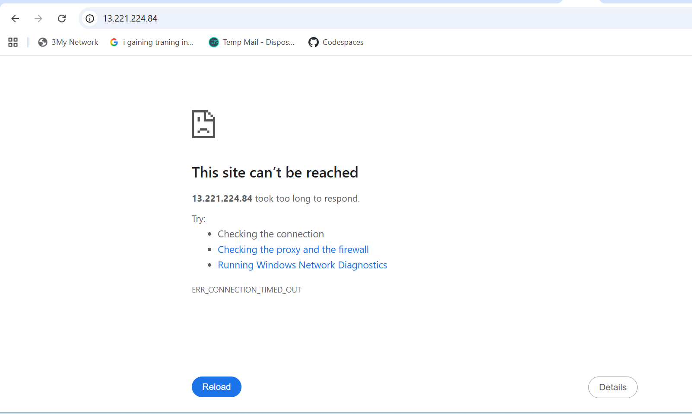
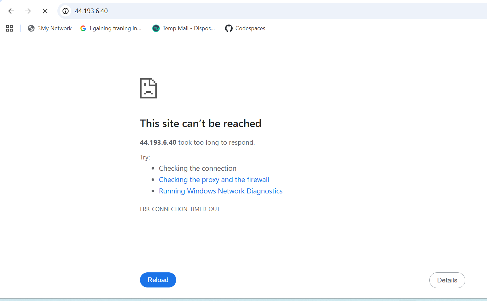

# Highly Available & Secure Multi-AZ Web Infrastructure on AWS

**Tech stack:** AWS EC2 · Application Load Balancer · VPC · Security Groups · Apache HTTP Server · Amazon Linux

## Project Overview

This project implements a highly available, fault-tolerant, and secure web architecture on AWS. An internet-facing **Application Load Balancer (ALB)** distributes traffic across two **Apache HTTP Servers** running in separate Availability Zones. The web servers accept HTTP traffic only from the load balancer, following the **Principle of Least Privilege**.

```
Internet → ALB (ALB_sec, port 80) → Target Group (TG) ─┬→ Apache Server 1 (us-east-1a)
                                                       └→ Apache Server 2 (us-east-1b)
```

## Key Features

- **High availability:** Instances run in `us-east-1a` and `us-east-1b`, so the loss of one data center does not take the application down.
- **Load balancing:** The ALB is the single entry point for clients and routes requests only to healthy targets.
- **Restricted access:** The instance security group (`appache-sec`) accepts HTTP only from the ALB's security group (`ALB_sec`). Direct access to the instances is blocked.
- **Automated setup:** EC2 User Data installs and configures Apache automatically at launch.

## Components

### 1. Compute (Amazon EC2)

| Instance | Type | OS | Availability Zone |
|----------|------|----|-------------------|
| Apache Server 1 | `t3.micro` | Amazon Linux | `us-east-1a` |
| Apache Server 2 | `t3.micro` | Amazon Linux | `us-east-1b` |

Each instance serves a unique page so load distribution is easy to see. User Data script ([`scripts/user-data.sh`](scripts/user-data.sh)):

```bash
#!/bin/bash
yum update -y
yum install -y httpd
systemctl start httpd
systemctl enable httpd
echo "<h1>Hello from Apache Server 1</h1>" > /var/www/html/index.html
```

On the second instance, the page text is changed to `Hello from Apache Server 2`.



### 2. Load Balancing (Elastic Load Balancing)

- **Type:** Application Load Balancer, internet-facing, IPv4
- **Name:** `MyALB`, spanning 2 Availability Zones
- **Listener:** HTTP on port 80, forwarding to the target group
- **Target Group:** `TG` (HTTP, port 80, target type: Instance) with both servers registered
- **Algorithm:** Round robin (ALB default)





### 3. Network Security

| Security Group | Inbound rule |
|----------------|--------------|
| `ALB_sec` (load balancer) | HTTP, port 80, from `0.0.0.0/0` |
| `appache-sec` (web servers) | HTTP, port 80, **source = `ALB_sec`** (security group reference, not an IP range) |



## Implementation Steps

### Phase 1: Deployment

1. **Launched two EC2 instances** in different Availability Zones, each with a User Data script that installs Apache and sets a unique index page.
2. **Created a Target Group** (HTTP, port 80) and registered both instances.
3. **Created the Application Load Balancer** across both AZ subnets, with a port 80 listener forwarding to the target group.
4. **Tested load distribution** by opening the ALB DNS name repeatedly. Responses alternate between the two servers:




### Phase 2: Security Hardening

1. **Reviewed the default rules** on the instance security group and removed the open `0.0.0.0/0` rule for port 80.
2. **Added a new rule** allowing port 80 only from the `ALB_sec` security group.
3. **Verified the lockdown:**
   - Accessing each instance's public IPv4 address directly now times out (`ERR_CONNECTION_TIMED_OUT`).
   - Accessing the application through the ALB DNS name still works normally.




## Limitations & Future Improvements

- **Private subnets:** The instances currently have public IPs. Security groups block direct access, but moving them to private subnets behind a NAT gateway would provide true network isolation.
- **HTTPS:** Add an ACM certificate and a port 443 listener, with HTTP redirecting to HTTPS.
- **Auto Scaling:** Add an Auto Scaling Group so failed instances are replaced and capacity adjusts to load.
- **Infrastructure as Code:** Rebuild the setup with Terraform or CloudFormation for repeatable deployments.
- **Monitoring:** Add CloudWatch alarms and ALB access logs.

## Cost Note

The ALB is billed hourly plus usage, and `t3.micro` instances may fall outside the free tier depending on the account. Delete resources when finished.

## Cleanup

1. Delete the Application Load Balancer.
2. Delete the Target Group.
3. Terminate both EC2 instances.
4. Delete the custom security groups (`ALB_sec` and `appache-sec`).
